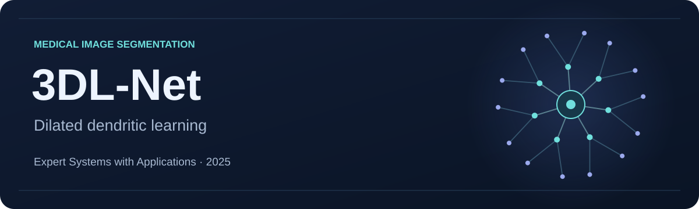
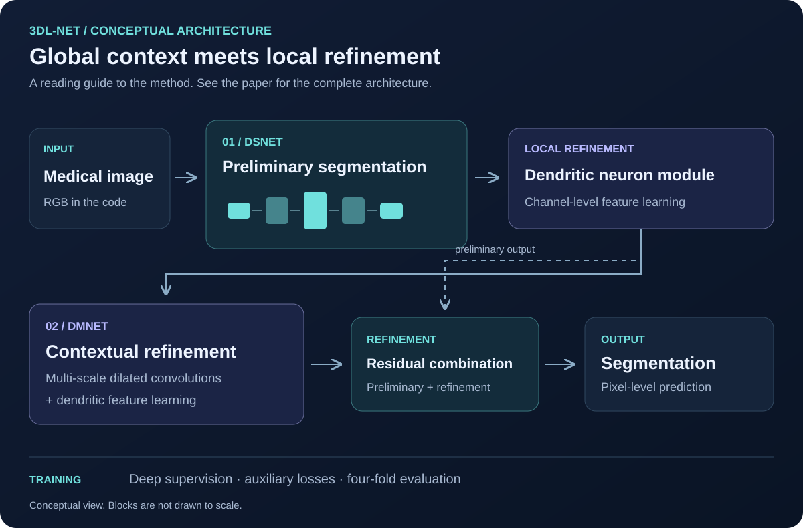

<div align="center">

**[Read the paper](https://doi.org/10.1016/j.eswa.2024.125874)** &nbsp; · &nbsp; **[Explore the model](model_net.py)** &nbsp; · &nbsp; **[Run an experiment](#run-an-experiment)** &nbsp; · &nbsp; **[Cite this work](#citation)**

*Expert Systems with Applications · Volume 264 · Article 125874 · 2025*

</div>

## Overview

Accurate medical image segmentation requires both broad spatial context and fine local detail. **3DL-Net** brings these together through multi-scale dilated convolutions and biologically inspired dendritic learning.

This repository accompanies **Dilated dendritic learning of global–local feature representation for medical image segmentation** by Zhipeng Liu and colleagues. It includes the PyTorch model, four-fold experiments, baseline comparisons and visualization utilities.

## How It Works



1. **Build an initial segmentation.** DSNet extracts image features through an encoder–decoder with deep supervision.
2. **Refine local representations.** Dendritic neuron modules learn channel-level feature interactions.
3. **Recover contextual information.** DMNet combines multi-scale context and dendritic refinement with the preliminary output.

The figure is a conceptual reading guide. The paper describes the full architecture; the implementation is named `RRCNet` in [`model_net.py`](model_net.py).

## Explore the Code

| Start here | What you will find |
| --- | --- |
| [`model_net.py`](model_net.py) · [`conv_dnm.py`](conv_dnm.py) | Network architecture and dendritic modules |
| [`k_folder.py`](k_folder.py) · [`dataset.py`](dataset.py) | Four-fold training, metrics and data loading |
| [`compare_kfold.py`](compare_kfold.py) | Baseline-model experiments |
| [`predicted.py`](predicted.py) · [`pic_merged.py`](pic_merged.py) | Prediction export and figure composition |

## Run an Experiment

The scripts retain experiment-specific configuration. Prepare a compatible environment and dataset before running the training command. Expand the guides below for exact paths, dependencies and current implementation details.

<details>
<summary><b>01 · Set up the environment</b></summary>

```bash
git clone https://github.com/lzp990616/3DL-Net.git
cd 3DL-Net
python -m venv .venv
```

Activate with `source .venv/bin/activate` on Linux/macOS or `.venv\Scripts\Activate.ps1` in Windows PowerShell. Install mutually compatible PyTorch/torchvision versions for your hardware, then the packages imported by the main training path:

```bash
python -m pip install torch torchvision
python -m pip install numpy Pillow opencv-python scikit-learn matplotlib tqdm torchmetrics MedPy torchsummary torchstat
```

**Compatibility:** the main training script has no pinned environment. It imports legacy TorchMetrics APIs including `dice_score` and `precision_recall`; newer releases may need import/API changes. The commands list dependencies, not a verified version lock. Comparison models also import packages such as `einops`, `timm` and `fairscale`.

</details>

<details>
<summary><b>02 · Prepare images, masks and dataset paths</b></summary>

Obtain datasets separately using the sources and access conditions cited in the paper. For example:

```text
3DL-Net/
└── data/
    ├── STU-Hospital-master/
    │   └── data_mask/
    │       ├── images/
    │       └── masks/
    └── BUS/
        └── BUS/
            └── data_mask/
                ├── images/
                └── masks/
```

The four-fold loader sorts image and mask filenames separately and pairs them by index. Ensure equal file counts and corresponding sorted filenames. The main training script loads images as RGB and masks as grayscale, resizing both to 384 × 384.

### Dataset selectors

These are the branches in `k_folder.py`, rather than a list of the paper's evaluation datasets:

| `--data_name` | Default root path |
| --- | --- |
| `stu` | `./data/STU-Hospital-master/` |
| `bus` | `./data/BUS/BUS/` |
| `busi` | `./data/Dataset_BUSI/Dataset_BUSI_with_GT/` |
| `polyp` | `./data/Kvasir-SEG/` |
| `brain` | `./data/brain_tumor/` |

Each root must contain `data_mask/images/` and `data_mask/masks/`. Edit path constants if your layout differs. The paper also evaluates COVID-19 data, but `k_folder.py` currently has no `covid` branch; configure one before training on that dataset.

### Optional directory-based split

`k_folder.py` reads `data_mask/` directly and creates four folds internally; it does **not** require `data_spilt.py` first.

Prediction utilities instead read `data/train/` and `data/val/`. If using `data_spilt.py`, set its `filepath` to the intended dataset root with a trailing slash. Current defaults are 80% training, 20% validation and 0% test. The script **deletes and recreates** the six split directories under that root; preserve any split you need before running it.

```bash
python data_spilt.py
```

</details>

<details open>
<summary><b>03 · Train and evaluate 3DL-Net</b></summary>

Create the log directory before running the script:

```bash
python -c "from pathlib import Path; Path('log').mkdir(exist_ok=True)"
python k_folder.py --data_name stu --log_name ./log/3dlnet_stu.log --EPOCH 100 --LR 0.00005 --LOSSK 0.1 --loss_name dynamic_focal --DNM 1 --DNM_MR 1 --M 10 --flag_deeplab 1 --DEVICE 0
```

The script uses four-fold cross-validation with shuffled splits and Adam optimization. Logs include training loss, Dice, Jaccard and other validation metrics.

| Argument | Default | Meaning |
| --- | --- | --- |
| `--data_name` | `stu` | Dataset selector above |
| `--EPOCH` | `100` | Epochs per fold |
| `--LR` | `0.00005` | Learning rate |
| `--LOSSK` | `0.1` | Weight on auxiliary loss terms |
| `--loss_name` | `dynamic_focal` | `dynamic_focal`, `focal` or `dice` |
| `--M` | `10` | Number of dendrites |
| `--DNM` | `1` | Dendritic module flag passed to `RRCNet` |
| `--DNM_MR` | `1` | Refinement-branch dendritic module flag |
| `--flag_deeplab` | `1` | Dilated-context branch flag |
| `--DEVICE` | `0` | `0` selects `cuda:0`; other values select `cuda:1` when CUDA is available |
| `--log_name` | `./log/test3_8.log` | Log path; use a different name per run |

### Implementation notes

- Main training DataLoaders use a fixed batch size of **6** and `drop_last=True`. The parsed `--batch_size` option does not override these values.
- `KFold` has no fixed `random_state`, so repeated runs can use different splits. Preserve splits and environment settings when comparing experiments.
- Checkpoint-saving code in `k_folder.py` is commented out, and its parsed `--ckpt` option is not wired into loading. Configure saving/loading if trained weights are needed.
- These instructions describe the checked-in code; they do not claim a fresh end-to-end reproduction of the paper's results. Refer to the paper for reported metrics and the experimental protocol.

</details>

<details>
<summary><b>04 · Compare baseline models</b></summary>

`compare_kfold.py` provides baseline experiments. Check its model imports and dataset branches before running; they differ from the main script. Example with U-Net on STU:

```bash
python compare_kfold.py --data_name stu --model_name unet --log_name ./log/unet_stu.log --EPOCH 100 --LR 0.00005 --DEVICE 0
```

The comparison DataLoaders currently use a fixed batch size of 12; their parsed `--batch_size` option does not override it. Use matching data, folds and evaluation settings for meaningful comparisons.

</details>

<details>
<summary><b>05 · Export predictions and visualizations</b></summary>

Prediction scripts require a compatible trained checkpoint and dataset split. Review their script-level paths before running:

| Script | Configuration to check |
| --- | --- |
| `predicted.py` | Dataset selector, `pretrained_model` (currently `./pic/model/dnm_bus.pth`), model flags and output directories |
| `predicted_other_model.py` | Model selection, dataset path (currently COVID-19), checkpoint path and output directories |
| `pic_*.py` | Paths for figure composition, ablations and feature visualization |

The prediction loaders expect `data/train`, `data/trainannot`, `data/val` and `data/valannot` under the dataset root. Checkpoints are loaded from a dictionary containing `model_static_dict`. Update the script-level checkpoint path; passing `--ckpt` alone does not replace it. Create the output directories referenced by the script before exporting images.

```bash
# After configuring data, checkpoint and output paths:
python predicted.py --data_name bus --log_name ./log/predict_bus.log
```

No pretrained `.pth` or `.pt` weights are included in this checkout.

</details>

## Reproducibility

The examples have been checked against the source code, but are not a new reproduction of the paper's experiments. For comparable results, preserve data splits, dependency versions and evaluation settings. Reported experimental results and dataset references are in the [paper](https://doi.org/10.1016/j.eswa.2024.125874).

## Citation

If this work is useful to your research, please cite:

```bibtex
@article{liu2025dilated,
  title={Dilated dendritic learning of global--local feature representation for medical image segmentation},
  author={Liu, Zhipeng and Song, Yaotong and Yi, Junyan and Zhang, Zhiming and Omura, Masaaki and Lei, Zhenyu and Gao, Shangce},
  journal={Expert Systems with Applications},
  volume={264},
  pages={125874},
  year={2025},
  doi={10.1016/j.eswa.2024.125874},
  publisher={Elsevier}
}
```

## License and Third-Party Code

No top-level license file is included in this repository. Bundled third-party implementations include their own license files; refer to those files and the original projects for their terms.

## Questions

[Open an issue](https://github.com/lzp990616/3DL-Net/issues) with your command, environment and error message for code or reproducibility questions.
